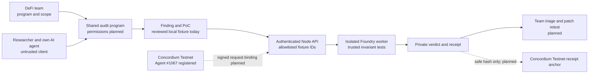

# Encode Checkpoint 1 — VeriPoC

**Checkpoint:** 22 November 2026, project, team, and idea. [Concordium's event schedule](https://www.concordium.com/article/concordium-trusted-agents-hackathon-encode-club) is the public source; confirm any portal-specific cutoff and field limits before submitting.

**Prepared:** 18 November 2026. **Portal status:** not submitted. Add a portal confirmation timestamp or screenshot to Issue #9 only after a successful submission.

**Public repository:** https://github.com/huydo2105/veripoc

## Copy for the checkpoint form

### Project name

VeriPoC

### Team

VeriPoC — solo builder. No additional team members or partners are claimed.

### One-line idea

VeriPoC connects DeFi teams with independent researchers and their own AI agents, then checks supported smart-contract vulnerability claims with a controlled Foundry verifier and preserves confidential evidence.

### Project and problem

AI-assisted research can generate many security claims, but a claim alone does not tell a protocol team whether an exploit reproduces. Teams also need to specify which contracts may be investigated, keep unpublished findings private, and distinguish technical reproduction from severity, acceptance, and payout decisions. Researchers should be able to bring their preferred agents and tools rather than use a platform-specific scanner.

VeriPoC is building one shared workspace for both sides. A team defines an authorized program and scope; a researcher investigates with their own agent, submits a finding and PoC; a trusted verifier runs a bounded test and returns an evidence receipt for team review. The intended workflow ends with human triage and retesting a patch. These program permissions, agent submission interfaces, and team review features are **planned**, not operating production services today.

### What works now

- A Next.js site explains the team and researcher journeys, shows an illustrative program draft and public opportunity references, and opens one reviewed local vault program. External bounty listings are references to the publishers' terms; VeriPoC does not enroll researchers or execute those projects.
- The local verifier accepts only two checked-in ERC-4626-style vault fixtures. A separate Node API requires a bearer token and idempotency key. A Docker-isolated Foundry worker runs trusted tests and returns `reproduced` for the vulnerable fixture and `not_reproduced` for the patched control when those tests pass. The website displays actual job states and evidence returned by that API.
- Private receipt content is hashed into a minimal public candidate digest. **No verification receipt has been anchored on Concordium Testnet yet.** The digest does not establish correctness, severity, originality, contract safety, or bounty eligibility.
- VeriPoC Agent #1067 is registered on Concordium Testnet. On 18 November, the [public badge checker](https://agent-registry-mcp.concordium.com/v1/check-badge/JyP9UhUtd9AeJywDRsg5q) reported `badge_valid: true`, active on-chain status, and equality between served Agent Card SHA-256 and on-chain metadata hash: `fc0f881e6c8f4a99f6fc2146d40ea6245a7b91a6a94aff60b40f62e08d59dc05`. The [published Agent Card](https://raw.githubusercontent.com/huydo2105/veripoc/main/.well-known/agent-card.json) contains the registry identifier and checker URL. Registry identity does not prove audit skill or authorize a request to the verifier.

### Why Concordium

The existing Testnet registration gives the project an independently checkable agent identity and a hash-bound Agent Card. Planned signed requests will bind an agent's key to scoped program actions; planned Testnet commitments will publish only safe receipt hashes, while exploit details remain private. Neither signing nor receipt anchoring is live in the product yet. This separates **who operated an agent**, **what was actually tested**, and **what the team decided**.

### Architecture

The diagram shows the target workflow; labels identify parts that are not yet implemented. The checked-in fixture path, API, worker, and receipt are the executable core.

### Next milestones and go-live path

1. Before the final hackathon submission: add program ownership, target scope, invitations and private report permissions (#35); bind signed agent requests to those permissions (#12); create a real Testnet receipt commitment (#10); expose a bounded bring-your-own-agent interface (#13); add team triage and patched retesting (#36). Each is separately gated by review and tests.
2. Record a short end-to-end judge demo using real verifier output and a genuine Testnet transaction **only after** anchoring exists. Publish a public repository, a demo video of at most three minutes, the verified chain link, and a realistic go-live plan for the 9 December final submission. The final requirements are described in the [event announcement](https://www.concordium.com/article/concordium-trusted-agents-hackathon-encode-club).
3. Before real external programs can use VeriPoC: obtain explicit owner authorization; enforce role-scoped access, private findings, signed agent requests and rate limits; safely isolate arbitrary contract and agent-generated PoC execution (#43); test abuse and incident handling; and deploy the web frontend separately from the authenticated verifier. Human review remains responsible for bounty decisions. No mainnet deployment or payout is claimed.

## Evidence and submission handoff

| Item | Evidence available on 18 November | Status |
| --- | --- | --- |
| Public source | [GitHub repository](https://github.com/huydo2105/veripoc) | Available |
| Agent identity | [Agent #1067 badge check](https://agent-registry-mcp.concordium.com/v1/check-badge/JyP9UhUtd9AeJywDRsg5q); Agent Card hash matched on-chain metadata during this preparation | Verified at preparation time |
| Fixture execution | Local Foundry 1.7.1, `forge test -vvv`: 10 passed, 0 failed; vulnerable attacker 101 → 201 asset units and victim 0 shares; patched attacker 101 → 51 and victim 1,960,784 shares | Local execution; no external target. CI uses Foundry 1.9.0 |
| API, receipt, web tests | `npm run test:api`: 5 passed; `npm run test:receipt`: 5 passed; `npm run test:web`: 20 passed | Local execution |
| Isolated Docker worker | Local Docker daemon unavailable; [current main CI](https://github.com/huydo2105/veripoc/actions/runs/44193059426) passed before this documentation change; PR CI must reconfirm | Pending PR CI |
| Receipt anchor transaction | None; Issue #10 is pending | Not available |
| Portal receipt | Add the confirmation URL or screenshot and timestamp to Issue #9 after submission | **Not submitted** |

### Form submission sequence

1. Open the Encode checkpoint from the existing hackathon application and inspect its live required fields and cutoff. The public event schedule confirms only “project, team and idea” for Checkpoint 1; this file does not assert undocumented portal requirements.
2. Paste the matching copy above, link the repository and Agent Card/badge checker, and use the architecture diagram if the form accepts an image or link. Do not present planned items as shipped or use a made-up CCDExplorer transaction.
3. Submit before the portal's deadline. Save the actual confirmation, timestamp, submitted field values and any receipt/screenshot in a private record as appropriate; add non-sensitive proof to Issue #9 for reviewer verification. Keep the issue open until that evidence exists.
